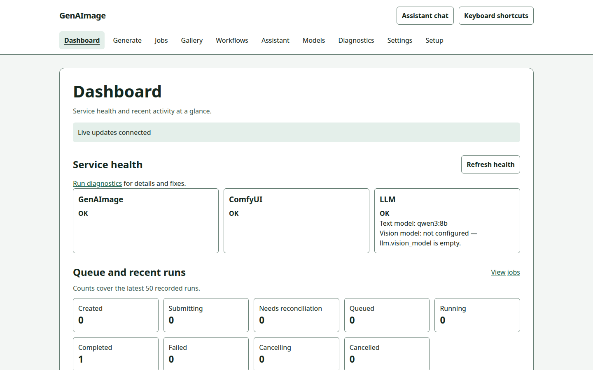
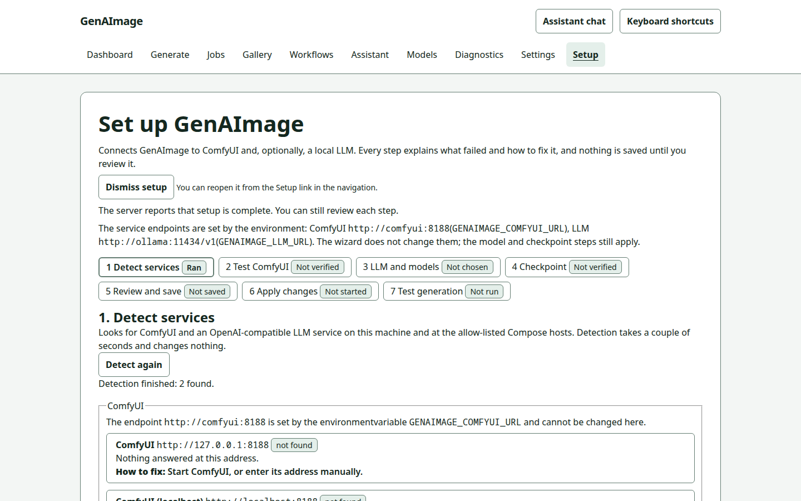
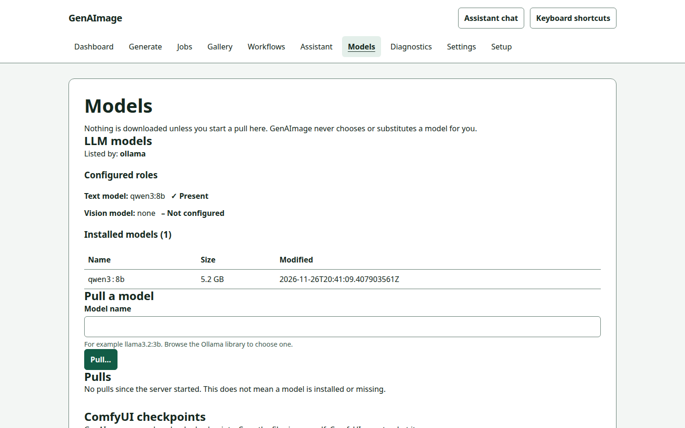
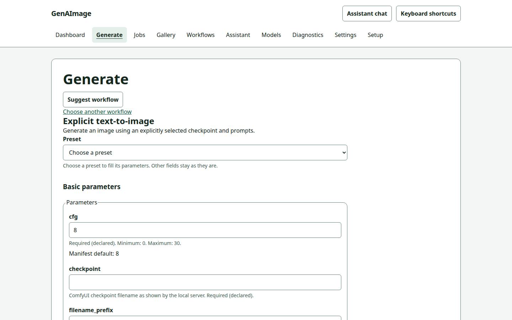
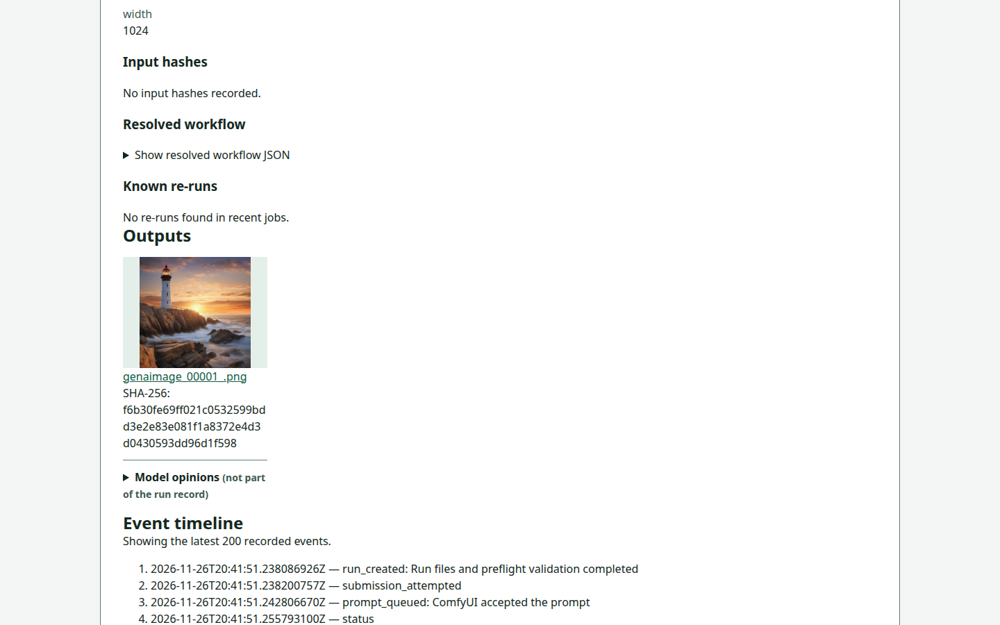
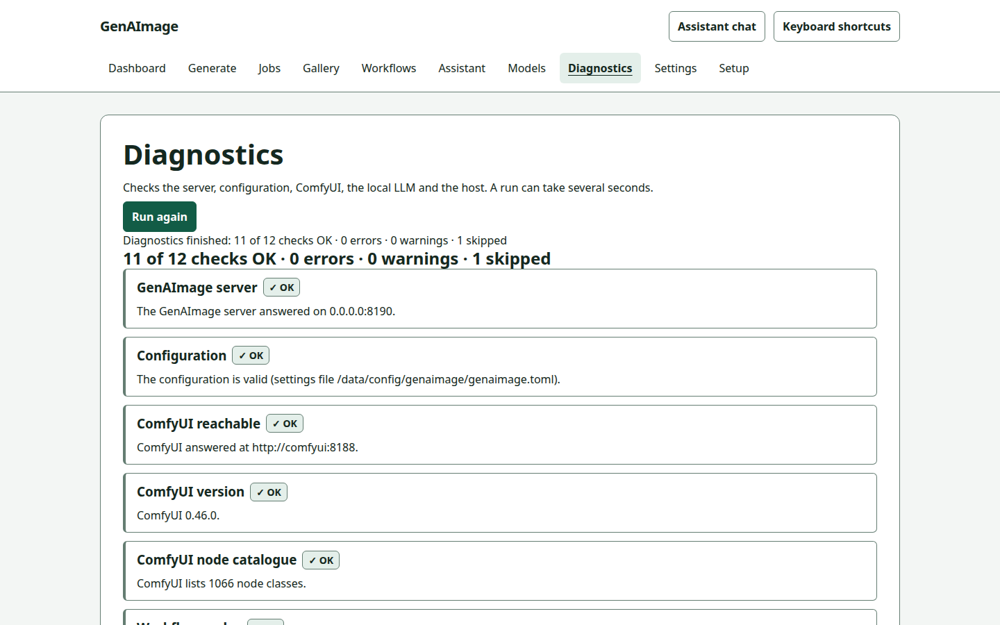

# GenAImage

GenAImage is a thin, fast, local harness for controlled, inspectable image
generation. ComfyUI generates the images, local OpenAI-compatible LLMs (such as
Ollama) assist, and every generation choice stays explicit: nothing silently
substitutes a model, seed, prompt or setting, and the assistant never submits a
run without your confirmation. It runs as a loopback server with an embedded web
portal and a scripted CLI. See [ADR 0001](docs/adr/0001-target-architecture.md)
and the [architecture](docs/architecture.md).

ComfyUI, models, weights and custom nodes remain separate and external.
GenAImage never installs, bundles or substitutes them, and downloads a model
only when you ask. The server binds to loopback only and is not authenticated;
do not expose it.



## Quick start: Docker Compose

Needs Docker with Compose. The first start builds the GenAImage and ComfyUI
images from this repository (several minutes). The default stack runs ComfyUI on
the CPU; for AMD ROCm or NVIDIA, choose an accelerator in `.env` first (see
[Docker Compose](docs/compose.md#accelerators)).

```bash
cp .env.example .env
docker compose up -d
```

Open `http://127.0.0.1:8190`. The setup wizard opens automatically while setup
is needed (also at `#/setup`). The stack contains no models, so you choose them:

1. Add a checkpoint to ComfyUI, for example
   `docker compose cp ./sd_xl_base_1.0.safetensors comfyui:/opt/comfyui/models/checkpoints/`.
   Download it yourself and check its licence; see [models](docs/models.md).
2. Pull an LLM on the portal's Models page (`#/models`) or with
   `docker compose exec genaimage genaimage models pull <model>`. Model names
   such as `qwen3:8b` are examples, not defaults.
3. Select the LLM in the wizard, or set `GENAIMAGE_LLM_TEXT_MODEL` in `.env`.
4. Run the wizard's test generation, then open Generate.





## Quick start: binary with existing ComfyUI and Ollama

Prerequisites: a running ComfyUI (default `http://127.0.0.1:8188`) and, for the
assistant, an OpenAI-compatible LLM such as Ollama.

Published release binaries and container images are not yet available: nothing
is published until the first release tag exists (see [setup](docs/setup.md#releases)).
Until then, build from source with Rust 1.80 or newer and Node.js 24:

```bash
(cd apps/portal && npm ci && npm run build)
cargo install --locked --path crates/genaimage
```

Then configure, serve and check:

```bash
genaimage config init        # writes ./genaimage.toml; edit the endpoints
genaimage serve              # http://127.0.0.1:3000
genaimage doctor             # in a second terminal
```

The server starts without ComfyUI; `doctor` tells you what is missing and how
to fix it ([troubleshooting](docs/troubleshooting.md#doctor-checks)). An API-only
build without Node.js needs `--no-default-features`.

## First generation

Use the portal (Generate), or the CLI with every non-default value explicit:

```bash
genaimage workflow list
genaimage run text-to-image --preset fast \
  --set checkpoint='"my-local-checkpoint.safetensors"' \
  --set positive_prompt='"an approved, specific visual description"' --wait
```







## Documentation

The full index is in [docs/README.md](docs/README.md). Start with:

- [Setup](docs/setup.md) and [Docker Compose](docs/compose.md)
- [Models](docs/models.md): checkpoints and LLM pulls
- [Configuration](docs/configuration.md), [CLI](docs/cli.md) and [API](docs/api.md) references
- [Workflow manifest](docs/workflow-manifest.md)
- [Extending GenAImage](docs/extending.md): image backends, LLM providers, assistant tools, event sinks and workflow packs
- [Troubleshooting](docs/troubleshooting.md)

## What it does and does not do

- One local ComfyUI host, with ComfyUI API-format workflows and strict
  `*.genaimage.json` manifests; submission is explicit and idempotent.
- Queue tracking, progress, cancellation and reconciliation after a restart;
  an ambiguous submission is reconciled, never blindly retried.
- SQLite state and checksummed run manifests for provenance.
- Not in scope: remote or multi-host routing, cloud storage, installing models
  or custom nodes, authentication.

## Development

Run all repository checks (it installs portal dependencies and builds the portal
first):

```bash
python3 scripts/ci_check.py
```

See the [testing guide](docs/testing.md), [releasing](docs/releasing.md) and
[performance budgets](docs/performance.md). Contributors and agents also read
[AGENTS.md](AGENTS.md).

### Portal development

The Svelte 5 portal has responsive navigation and system light/dark themes. For
hot module replacement (HMR), run the server on the
port configured in Vite's `/api` proxy and open the loopback URL printed by Vite:

```bash
GENAIMAGE_SERVER_PORT=8190 cargo run -p genaimage --no-default-features -- serve
# Separate terminal:
cd apps/portal
npm ci
npm run dev
```

To see the development UI on the GenAImage origin instead, start GenAImage
with `serve --portal-dev-url http://127.0.0.1:5173`. GenAImage still handles
`/api` locally. Its UI proxy forwards HTTP GET/HEAD, not WebSocket upgrades;
refresh manually or open Vite directly for HMR. The flag works without the
embedded portal feature. Routes use URL fragments, such as
`#/generate?workflow=example`. Use **Keyboard shortcuts** (or `?`) to view
shortcuts or turn off character-key shortcuts. See the [portal UI handoff](docs/architecture.md#portal-ui)
for reusable components.

## Project agent and skills

In GitHub Copilot Chat, select the **GenAImage** agent. It routes requests to the
focused project skills and the implemented ComfyUI workflow. It does not imply
that a required ComfyUI host, model or node exists.

Project-local skills remain installed under `.agents/skills/` and mirrored
unchanged under `.claude/skills/`.
